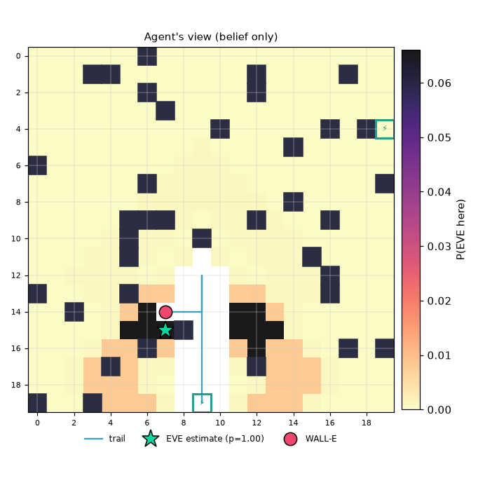

# Mission report: default_mission / EVE-Seeker (EIG) / seed 7

**Outcome:** `success`  (success=True)

| metric | value |
|---|---|
| strategy | eve_seeker |
| seed | 7 |
| status | success |
| success | True |
| actions | 14 |
| scans | 3 |
| recharges | 0 |
| invalid_actions | 0 |
| energy_used | 20.0 |
| time_used | 17 |
| resource_exhausted | False |
| final_error | 0.0 |
| localized_exact | True |
| localized_within2 | True |
| final_entropy | 0.0 |
| final_confidence | 1.0 |

Legend: W=WALL-E, E=EVE (ground truth, shown post-mission only), c=clue, S=station, +=trail, #=obstacle

```
......#.............
...##.......#....#..
......#.....#.......
..c....#............
..........#.....#.#S
..............#.....
#...................
......#............#
..............#.....
.....###....#...#...
.....#...#..........
.....#.........#.c..
.........+......#...
#....#...+......#...
..#....W++..........
.......E#+..........
......#..+.......#.#
....#....+..#.......
.........+..c.......
#..#.....S..........
```



## Decision log

| step | action | why |
|---|---|---|
| 1 | MOVE N | [info-gain] go to (9, 18) and scan: expected info gain 0.39 bits, cost 5.5, score 0.071; best of 652 feasible options, entropy 8.48 bits |
| 2 | SCAN | [info-gain] scan here: expected info gain 0.31 bits, cost 4.0, score 0.077; best of 652 feasible options, entropy 8.47 bits |
| 3 | MOVE N | [info-gain] go to (9, 17) and scan: expected info gain 0.57 bits, cost 5.5, score 0.104; best of 620 feasible options, entropy 7.76 bits |
| 4 | SCAN | [info-gain] scan here: expected info gain 0.53 bits, cost 4.0, score 0.132; best of 620 feasible options, entropy 7.74 bits |
| 5 | MOVE N | [info-gain] go to (9, 14) and scan: expected info gain 1.06 bits, cost 8.5, score 0.125; best of 568 feasible options, entropy 6.38 bits |
| 6 | MOVE N | [info-gain] go to (9, 14) and scan: expected info gain 1.06 bits, cost 7.0, score 0.151; best of 568 feasible options, entropy 6.37 bits |
| 7 | MOVE N | [info-gain] go to (9, 14): expected info gain 0.42 bits, cost 1.5, score 0.280; best of 568 feasible options, entropy 6.35 bits |
| 8 | MOVE N | [info-gain] go to (9, 13): expected info gain 0.44 bits, cost 1.5, score 0.294; best of 568 feasible options, entropy 6.31 bits |
| 9 | MOVE N | [info-gain] go to (9, 12): expected info gain 0.46 bits, cost 1.5, score 0.309; best of 563 feasible options, entropy 6.27 bits |
| 10 | SCAN | [info-gain] scan here: expected info gain 0.48 bits, cost 4.0, score 0.121; best of 547 feasible options, entropy 6.22 bits |
| 11 | MOVE S | [info-gain] go to (12, 15): expected info gain 1.61 bits, cost 9.0, score 0.179; best of 442 feasible options, entropy 5.33 bits |
| 12 | MOVE S | [info-gain] go to (12, 15): expected info gain 1.61 bits, cost 7.5, score 0.215; best of 383 feasible options, entropy 5.33 bits |
| 13 | MOVE W | [info-gain] go to (7, 14): expected info gain 1.05 bits, cost 3.0, score 0.350; best of 298 feasible options, entropy 5.33 bits |
| 14 | MOVE W | [info-gain] go to (7, 14): expected info gain 0.76 bits, cost 1.5, score 0.509; best of 231 feasible options, entropy 5.32 bits |