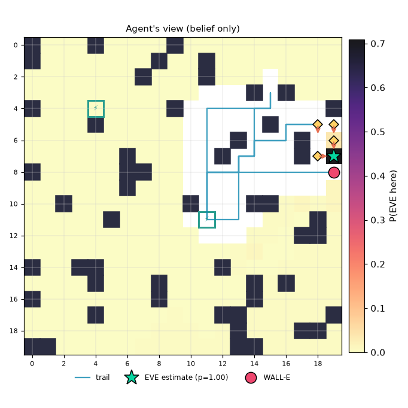

# Mission report: noisy_decoys / EVE-Seeker w/o EIG (ablation) / seed 3

**Outcome:** `success`  (success=True)

| metric | value |
|---|---|
| strategy | eve_seeker_no_eig |
| seed | 3 |
| status | success |
| success | True |
| actions | 79 |
| scans | 10 |
| recharges | 8 |
| invalid_actions | 0 |
| energy_used | 91.0 |
| time_used | 89 |
| resource_exhausted | False |
| final_error | 0.0 |
| localized_exact | True |
| localized_within2 | True |
| final_entropy | 0.0 |
| final_confidence | 1.0 |

Legend: W=WALL-E, E=EVE (ground truth, shown post-mission only), c=clue, S=station, +=trail, #=obstacle

```
#...#....#..........
#.......#..#........
.......#...#........
..............#+#...
#...S....#.+++++...#
....#......+..+#++cc
...........+.#+++#.c
......#....+#++..#cE
#.....##...++++++++W
......#....+.+......
..#.......#+.+##....
.....#.....S++....#.
.................##.
....................
#..##.......#.......
....#...#.....#.#...
#.......#.....#.....
....#.......##.....#
.............#...##.
##...........##.....
```



## Decision log

| step | action | why |
|---|---|---|
| 1 | SCAN | scheduled scan (every 4 steps; no EIG in this ablation) |
| 2 | MOVE E | [mass] go to (12, 11): belief mass in view 0.00, cost 1.5, score 0.002; best of 344 feasible options, entropy 8.30 bits |
| 3 | MOVE E | [mass] go to (13, 11): belief mass in view 0.00, cost 1.5, score 0.002; best of 343 feasible options, entropy 8.29 bits |
| 4 | MOVE N | [mass] go to (18, 9): belief mass in view 0.02, cost 10.5, score 0.002; best of 340 feasible options, entropy 8.28 bits |
| 5 | MOVE N | [mass] go to (13, 9): belief mass in view 0.00, cost 1.5, score 0.002; best of 337 feasible options, entropy 8.28 bits |
| 6 | SCAN | scheduled scan (every 4 steps; no EIG in this ablation) |
| 7 | MOVE N | [mass] go to (15, 2): belief mass in view 0.02, cost 13.5, score 0.002; best of 312 feasible options, entropy 8.13 bits |
| 8 | MOVE N | [mass] go to (15, 2): belief mass in view 0.02, cost 12.0, score 0.002; best of 304 feasible options, entropy 8.13 bits |
| 9 | MOVE E | [mass] go to (15, 2): belief mass in view 0.02, cost 10.5, score 0.002; best of 292 feasible options, entropy 8.13 bits |
| 10 | MOVE N | [mass] go to (15, 2): belief mass in view 0.02, cost 9.0, score 0.002; best of 279 feasible options, entropy 8.12 bits |
| 11 | SCAN | scheduled scan (every 4 steps; no EIG in this ablation) |
| 12 | MOVE N | [mass] go to (15, 2): belief mass in view 0.05, cost 7.5, score 0.006; best of 236 feasible options, entropy 7.98 bits |
| 13 | MOVE N | [mass] go to (15, 2): belief mass in view 0.05, cost 6.0, score 0.008; best of 223 feasible options, entropy 7.97 bits |
| 14 | MOVE E | [mass] go to (15, 4): belief mass in view 0.02, cost 1.5, score 0.013; best of 206 feasible options, entropy 7.97 bits |
| 15 | MOVE N | [mass] go to (15, 2): belief mass in view 0.04, cost 3.0, score 0.013; best of 186 feasible options, entropy 7.96 bits |
| 16 | SCAN | scheduled scan (every 4 steps; no EIG in this ablation) |
| 17 | MOVE S | heading to recharge station (11, 11) (12 steps away): slack 4 < 6 |
| 18 | MOVE W | heading to recharge station (11, 11) (11 steps away): slack 4 < 6 |
| 19 | MOVE W | heading to recharge station (11, 11) (10 steps away): slack 4 < 6 |
| 20 | MOVE W | heading to recharge station (11, 11) (9 steps away): slack 4 < 6 |
| 21 | MOVE W | heading to recharge station (11, 11) (8 steps away): slack 4 < 6 |
| 22 | MOVE S | heading to recharge station (11, 11) (7 steps away): slack 4 < 6 |
| 23 | MOVE S | heading to recharge station (11, 11) (6 steps away): slack 4 < 6 |
| 24 | MOVE S | heading to recharge station (11, 11) (5 steps away): slack 4 < 6 |
| 25 | MOVE S | heading to recharge station (11, 11) (4 steps away): slack 4 < 6 |
| 26 | MOVE S | heading to recharge station (11, 11) (3 steps away): slack 4 < 6 |
| 27 | MOVE S | heading to recharge station (11, 11) (2 steps away): slack 4 < 6 |
| 28 | MOVE S | heading to recharge station (11, 11) (1 steps away): slack 4 < 6 |
| 29 | RECHARGE | recharging at station: arrived at station |
| 30 | RECHARGE | recharging (14/40) before resuming search |
| 31 | RECHARGE | recharging (24/40) before resuming search |
| 32 | RECHARGE | recharging (34/40) before resuming search |
| 33 | MOVE N | [mass] go to (18, 5): belief mass in view 0.11, cost 19.5, score 0.006; best of 345 feasible options, entropy 7.53 bits |
| 34 | SCAN | scheduled scan (every 4 steps; no EIG in this ablation) |
| 35 | MOVE N | [mass] go to (18, 5): belief mass in view 0.11, cost 18.0, score 0.006; best of 343 feasible options, entropy 7.43 bits |
| 36 | MOVE N | [mass] go to (18, 5): belief mass in view 0.11, cost 16.5, score 0.007; best of 339 feasible options, entropy 7.43 bits |
| 37 | MOVE E | [mass] go to (18, 5): belief mass in view 0.11, cost 15.0, score 0.008; best of 335 feasible options, entropy 7.43 bits |
| 38 | MOVE E | [mass] go to (18, 5): belief mass in view 0.11, cost 13.5, score 0.008; best of 330 feasible options, entropy 7.43 bits |
| 39 | SCAN | scheduled scan (every 4 steps; no EIG in this ablation) |
| 40 | MOVE N | [mass] go to (18, 5): belief mass in view 0.16, cost 12.0, score 0.013; best of 304 feasible options, entropy 7.05 bits |
| 41 | MOVE E | [mass] go to (18, 5): belief mass in view 0.16, cost 10.5, score 0.015; best of 292 feasible options, entropy 7.05 bits |
| 42 | MOVE N | [mass] go to (18, 5): belief mass in view 0.16, cost 9.0, score 0.018; best of 279 feasible options, entropy 7.05 bits |
| 43 | MOVE E | [mass] go to (18, 5): belief mass in view 0.16, cost 7.5, score 0.021; best of 262 feasible options, entropy 7.05 bits |
| 44 | SCAN | scheduled scan (every 4 steps; no EIG in this ablation) |
| 45 | MOVE E | [mass] go to (18, 5): belief mass in view 0.08, cost 6.0, score 0.013; best of 214 feasible options, entropy 7.55 bits |
| 46 | MOVE N | [mass] go to (18, 5): belief mass in view 0.08, cost 4.5, score 0.018; best of 191 feasible options, entropy 7.54 bits |
| 47 | MOVE E | [mass] go to (18, 5): belief mass in view 0.10, cost 3.0, score 0.032; best of 171 feasible options, entropy 7.16 bits |
| 48 | MOVE E | [mass] go to (18, 7): belief mass in view 0.12, cost 4.5, score 0.026; best of 141 feasible options, entropy 6.48 bits |
| 49 | MOVE W | heading to recharge station (11, 11) (13 steps away): slack 5 < 6 |
| 50 | MOVE W | heading to recharge station (11, 11) (12 steps away): slack 5 < 6 |
| 51 | MOVE S | heading to recharge station (11, 11) (11 steps away): slack 5 < 6 |
| 52 | MOVE W | heading to recharge station (11, 11) (10 steps away): slack 5 < 6 |
| 53 | MOVE W | heading to recharge station (11, 11) (9 steps away): slack 5 < 6 |
| 54 | MOVE S | heading to recharge station (11, 11) (8 steps away): slack 5 < 6 |
| 55 | MOVE W | heading to recharge station (11, 11) (7 steps away): slack 5 < 6 |
| 56 | MOVE S | heading to recharge station (11, 11) (6 steps away): slack 5 < 6 |
| 57 | MOVE W | heading to recharge station (11, 11) (5 steps away): slack 5 < 6 |
| 58 | MOVE W | heading to recharge station (11, 11) (4 steps away): slack 5 < 6 |
| 59 | MOVE S | heading to recharge station (11, 11) (3 steps away): slack 5 < 6 |
| 60 | MOVE S | heading to recharge station (11, 11) (2 steps away): slack 5 < 6 |
| 61 | MOVE S | heading to recharge station (11, 11) (1 steps away): slack 5 < 6 |
| 62 | RECHARGE | recharging at station: arrived at station |
| 63 | RECHARGE | recharging (15/40) before resuming search |
| 64 | RECHARGE | recharging (25/40) before resuming search |
| 65 | RECHARGE | recharging (35/40) before resuming search |
| 66 | MOVE N | [mass] go to (19, 8): belief mass in view 0.36, cost 16.5, score 0.022; best of 345 feasible options, entropy 5.19 bits |
| 67 | MOVE N | [mass] go to (19, 8): belief mass in view 0.36, cost 15.0, score 0.024; best of 345 feasible options, entropy 5.19 bits |
| 68 | SCAN | scheduled scan (every 4 steps; no EIG in this ablation) |
| 69 | MOVE N | [mass] go to (19, 8): belief mass in view 0.33, cost 13.5, score 0.025; best of 339 feasible options, entropy 5.36 bits |
| 70 | MOVE E | [mass] go to (19, 8): belief mass in view 0.33, cost 12.0, score 0.028; best of 335 feasible options, entropy 5.36 bits |
| 71 | MOVE E | [mass] go to (19, 8): belief mass in view 0.33, cost 10.5, score 0.032; best of 330 feasible options, entropy 5.36 bits |
| 72 | MOVE E | [mass] go to (19, 8): belief mass in view 0.33, cost 9.0, score 0.037; best of 324 feasible options, entropy 5.36 bits |
| 73 | SCAN | scheduled scan (every 4 steps; no EIG in this ablation) |
| 74 | MOVE E | [mass] go to (19, 8): belief mass in view 0.52, cost 7.5, score 0.070; best of 294 feasible options, entropy 4.38 bits |
| 75 | MOVE E | [mass] go to (19, 8): belief mass in view 0.52, cost 6.0, score 0.087; best of 279 feasible options, entropy 4.38 bits |
| 76 | MOVE E | [mass] go to (19, 8): belief mass in view 0.53, cost 4.5, score 0.117; best of 261 feasible options, entropy 4.34 bits |
| 77 | MOVE E | [mass] go to (19, 8): belief mass in view 0.53, cost 3.0, score 0.176; best of 228 feasible options, entropy 4.24 bits |
| 78 | SCAN | scheduled scan (every 4 steps; no EIG in this ablation) |
| 79 | MOVE E | [mass] go to (19, 8): belief mass in view 0.72, cost 1.5, score 0.480; best of 163 feasible options, entropy 2.57 bits |