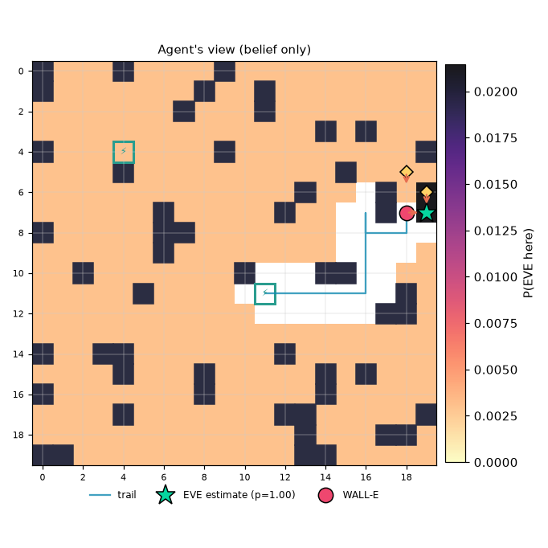

# Mission report: noisy_decoys / EVE-Seeker (EIG) / seed 3

**Outcome:** `success`  (success=True)

| metric | value |
|---|---|
| strategy | eve_seeker |
| seed | 3 |
| status | success |
| success | True |
| actions | 13 |
| scans | 0 |
| recharges | 0 |
| invalid_actions | 0 |
| energy_used | 13.0 |
| time_used | 13 |
| resource_exhausted | False |
| final_error | 0.0 |
| localized_exact | True |
| localized_within2 | True |
| final_entropy | 0.0 |
| final_confidence | 1.0 |

Legend: W=WALL-E, E=EVE (ground truth, shown post-mission only), c=clue, S=station, +=trail, #=obstacle

```
#...#....#..........
#.......#..#........
.......#...#........
..............#.#...
#...S....#.........#
....#..........#..cc
.............#...#.c
......#.....#...+#WE
#.....##........+++.
......#.........+...
..#.......#...##+...
.....#.....S+++++.#.
.................##.
....................
#..##.......#.......
....#...#.....#.#...
#.......#.....#.....
....#.......##.....#
.............#...##.
##...........##.....
```



## Decision log

| step | action | why |
|---|---|---|
| 1 | MOVE E | [info-gain] go to (12, 11): expected info gain 0.09 bits, cost 1.5, score 0.058; best of 690 feasible options, entropy 8.41 bits |
| 2 | MOVE E | [info-gain] go to (13, 11): expected info gain 0.09 bits, cost 1.5, score 0.058; best of 689 feasible options, entropy 8.40 bits |
| 3 | MOVE E | [info-gain] go to (14, 11): expected info gain 0.06 bits, cost 1.5, score 0.039; best of 685 feasible options, entropy 8.39 bits |
| 4 | MOVE E | [info-gain] go to (15, 11): expected info gain 0.06 bits, cost 1.5, score 0.039; best of 679 feasible options, entropy 8.38 bits |
| 5 | MOVE E | [info-gain] go to (16, 11): expected info gain 0.09 bits, cost 1.5, score 0.059; best of 671 feasible options, entropy 8.37 bits |
| 6 | MOVE N | [info-gain] go to (16, 10): expected info gain 0.06 bits, cost 1.5, score 0.040; best of 659 feasible options, entropy 8.36 bits |
| 7 | MOVE N | [info-gain] go to (16, 9): expected info gain 0.09 bits, cost 1.5, score 0.060; best of 646 feasible options, entropy 8.35 bits |
| 8 | MOVE N | [info-gain] go to (16, 8): expected info gain 0.09 bits, cost 1.5, score 0.061; best of 631 feasible options, entropy 8.34 bits |
| 9 | MOVE N | [info-gain] go to (16, 7): expected info gain 0.06 bits, cost 1.5, score 0.041; best of 614 feasible options, entropy 8.32 bits |
| 10 | MOVE S | [info-gain] go to (19, 7): expected info gain 0.50 bits, cost 7.5, score 0.066; best of 594 feasible options, entropy 8.21 bits |
| 11 | MOVE E | [info-gain] go to (19, 7): expected info gain 0.50 bits, cost 6.0, score 0.083; best of 586 feasible options, entropy 8.21 bits |
| 12 | MOVE E | [info-gain] go to (18, 8): expected info gain 0.24 bits, cost 1.5, score 0.159; best of 550 feasible options, entropy 8.21 bits |
| 13 | MOVE N | [info-gain] go to (18, 7): expected info gain 0.18 bits, cost 1.5, score 0.120; best of 501 feasible options, entropy 8.23 bits |