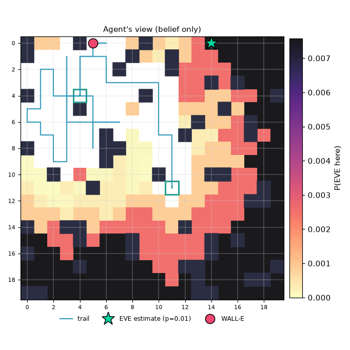

# Mission report: noisy_decoys / Greedy (MAP target) / seed 3

**Outcome:** `action_budget_exhausted`  (success=False)

| metric | value |
|---|---|
| strategy | greedy |
| seed | 3 |
| status | action_budget_exhausted |
| success | False |
| actions | 100 |
| scans | 17 |
| recharges | 12 |
| invalid_actions | 0 |
| energy_used | 122.0 |
| time_used | 117 |
| resource_exhausted | True |
| final_error | 12.0 |
| localized_exact | False |
| localized_within2 | False |
| final_entropy | 7.4383443148296315 |
| final_confidence | 0.007574812967581047 |

Legend: W=WALL-E, E=EVE (ground truth, shown post-mission only), c=clue, S=station, +=trail, #=obstacle

```
#...#W+..#..........
#..++++.#..#........
.++++.+#...#........
.++++.+++++...#.#...
#+++S+...#+........#
++.+#+....+....#..cc
++.+++++..+..#...#.c
.+++.+#...++#....#cE
#.++.+##...+........
..++..#....+........
..#.......#+..##....
.....#.....S......#.
.................##.
....................
#..##.......#.......
....#...#.....#.#...
#.......#.....#.....
....#.......##.....#
.............#...##.
##...........##.....
```



## Decision log

| step | action | why |
|---|---|---|
| 1 | SCAN | periodic scan (every 4 steps) |
| 2 | MOVE N | go to most probable reachable cell (11, 3) (p=0.004) |
| 3 | MOVE N | go to most probable reachable cell (11, 3) (p=0.004) |
| 4 | MOVE N | go to most probable reachable cell (11, 3) (p=0.004) |
| 5 | MOVE N | go to most probable reachable cell (11, 3) (p=0.004) |
| 6 | SCAN | periodic scan (every 4 steps) |
| 7 | MOVE W | go to most probable reachable cell (10, 0) (p=0.004) |
| 8 | MOVE N | go to most probable reachable cell (10, 0) (p=0.004) |
| 9 | MOVE N | go to most probable reachable cell (10, 0) (p=0.004) |
| 10 | MOVE N | go to most probable reachable cell (10, 0) (p=0.004) |
| 11 | SCAN | periodic scan (every 4 steps) |
| 12 | MOVE N | go to most probable reachable cell (6, 0) (p=0.005) |
| 13 | MOVE W | go to most probable reachable cell (6, 0) (p=0.005) |
| 14 | MOVE W | go to most probable reachable cell (6, 0) (p=0.005) |
| 15 | MOVE W | go to most probable reachable cell (6, 0) (p=0.005) |
| 16 | SCAN | periodic scan (every 4 steps) |
| 17 | MOVE W | go to most probable reachable cell (6, 0) (p=0.012) |
| 18 | MOVE N | go to most probable reachable cell (6, 0) (p=0.012) |
| 19 | MOVE N | go to most probable reachable cell (6, 0) (p=0.012) |
| 20 | MOVE W | go to most probable reachable cell (5, 0) (p=0.012) |
| 21 | SCAN | periodic scan (every 4 steps) |
| 22 | MOVE W | heading to recharge station (4, 4) (4 steps away): slack 5 < 6 |
| 23 | MOVE S | heading to recharge station (4, 4) (3 steps away): slack 5 < 6 |
| 24 | MOVE S | heading to recharge station (4, 4) (2 steps away): slack 5 < 6 |
| 25 | MOVE S | heading to recharge station (4, 4) (1 steps away): slack 5 < 6 |
| 26 | RECHARGE | recharging at station: arrived at station |
| 27 | RECHARGE | recharging (15/40) before resuming search |
| 28 | RECHARGE | recharging (25/40) before resuming search |
| 29 | RECHARGE | recharging (35/40) before resuming search |
| 30 | SCAN | periodic scan (every 4 steps) |
| 31 | MOVE W | go to most probable reachable cell (2, 2) (p=0.012) |
| 32 | MOVE W | go to most probable reachable cell (2, 2) (p=0.012) |
| 33 | MOVE N | go to most probable reachable cell (2, 2) (p=0.012) |
| 34 | MOVE N | go to most probable reachable cell (2, 1) (p=0.012) |
| 35 | SCAN | periodic scan (every 4 steps) |
| 36 | MOVE W | go to most probable reachable cell (1, 5) (p=0.028) |
| 37 | MOVE S | go to most probable reachable cell (1, 5) (p=0.028) |
| 38 | MOVE S | go to most probable reachable cell (1, 5) (p=0.028) |
| 39 | MOVE S | go to most probable reachable cell (0, 5) (p=0.029) |
| 40 | SCAN | periodic scan (every 4 steps) |
| 41 | MOVE W | go to most probable reachable cell (0, 6) (p=0.015) |
| 42 | MOVE S | go to most probable reachable cell (0, 7) (p=0.015) |
| 43 | MOVE E | go to most probable reachable cell (2, 6) (p=0.015) |
| 44 | MOVE S | go to most probable reachable cell (2, 7) (p=0.016) |
| 45 | SCAN | periodic scan (every 4 steps) |
| 46 | MOVE E | go to most probable reachable cell (3, 7) (p=0.006) |
| 47 | MOVE S | go to most probable reachable cell (3, 8) (p=0.006) |
| 48 | MOVE S | go to most probable reachable cell (5, 9) (p=0.006) |
| 49 | MOVE E | go to most probable reachable cell (5, 9) (p=0.006) |
| 50 | SCAN | periodic scan (every 4 steps) |
| 51 | MOVE N | heading to recharge station (4, 4) (6 steps away): slack 3 < 6 |
| 52 | MOVE N | heading to recharge station (4, 4) (5 steps away): slack 3 < 6 |
| 53 | MOVE N | heading to recharge station (4, 4) (4 steps away): slack 3 < 6 |
| 54 | MOVE N | heading to recharge station (4, 4) (3 steps away): slack 3 < 6 |
| 55 | MOVE N | heading to recharge station (4, 4) (2 steps away): slack 3 < 6 |
| 56 | MOVE E | heading to recharge station (4, 4) (1 steps away): slack 3 < 6 |
| 57 | RECHARGE | recharging at station: arrived at station |
| 58 | RECHARGE | recharging (13/40) before resuming search |
| 59 | RECHARGE | recharging (23/40) before resuming search |
| 60 | RECHARGE | recharging (33/40) before resuming search |
| 61 | MOVE W | go to most probable reachable cell (3, 0) (p=0.007) |
| 62 | SCAN | periodic scan (every 4 steps) |
| 63 | MOVE N | go to most probable reachable cell (3, 0) (p=0.020) |
| 64 | MOVE N | go to most probable reachable cell (3, 0) (p=0.020) |
| 65 | MOVE N | go to most probable reachable cell (3, 0) (p=0.020) |
| 66 | MOVE S | go to most probable reachable cell (8, 6) (p=0.021) |
| 67 | SCAN | periodic scan (every 4 steps) |
| 68 | MOVE S | go to most probable reachable cell (8, 6) (p=0.021) |
| 69 | MOVE S | go to most probable reachable cell (8, 6) (p=0.021) |
| 70 | MOVE S | go to most probable reachable cell (8, 6) (p=0.021) |
| 71 | MOVE S | go to most probable reachable cell (8, 6) (p=0.021) |
| 72 | SCAN | periodic scan (every 4 steps) |
| 73 | MOVE E | go to most probable reachable cell (8, 6) (p=0.007) |
| 74 | MOVE E | go to most probable reachable cell (8, 6) (p=0.007) |
| 75 | MOVE E | go to most probable reachable cell (8, 6) (p=0.007) |
| 76 | MOVE E | go to most probable reachable cell (8, 6) (p=0.007) |
| 77 | SCAN | periodic scan (every 4 steps) |
| 78 | MOVE W | go to most probable reachable cell (5, 9) (p=0.002) |
| 79 | MOVE W | go to most probable reachable cell (5, 9) (p=0.002) |
| 80 | MOVE S | go to most probable reachable cell (5, 9) (p=0.002) |
| 81 | MOVE S | go to most probable reachable cell (5, 9) (p=0.002) |
| 82 | SCAN | periodic scan (every 4 steps) |
| 83 | MOVE N | heading to recharge station (4, 4) (5 steps away): slack 3 < 6 |
| 84 | MOVE N | heading to recharge station (4, 4) (4 steps away): slack 3 < 6 |
| 85 | MOVE N | heading to recharge station (4, 4) (3 steps away): slack 3 < 6 |
| 86 | MOVE N | heading to recharge station (4, 4) (2 steps away): slack 3 < 6 |
| 87 | MOVE W | heading to recharge station (4, 4) (1 steps away): slack 3 < 6 |
| 88 | RECHARGE | recharging at station: arrived at station |
| 89 | RECHARGE | recharging (13/40) before resuming search |
| 90 | RECHARGE | recharging (23/40) before resuming search |
| 91 | RECHARGE | recharging (33/40) before resuming search |
| 92 | MOVE N | go to most probable reachable cell (7, 0) (p=0.003) |
| 93 | SCAN | periodic scan (every 4 steps) |
| 94 | MOVE N | go to most probable reachable cell (7, 0) (p=0.007) |
| 95 | MOVE N | go to most probable reachable cell (7, 0) (p=0.007) |
| 96 | MOVE E | go to most probable reachable cell (7, 0) (p=0.007) |
| 97 | MOVE N | go to most probable reachable cell (7, 0) (p=0.007) |
| 98 | SCAN | periodic scan (every 4 steps) |
| 99 | MOVE E | go to most probable reachable cell (7, 0) (p=0.003) |
| 100 | MOVE W | go to most probable reachable cell (5, 0) (p=0.000) |