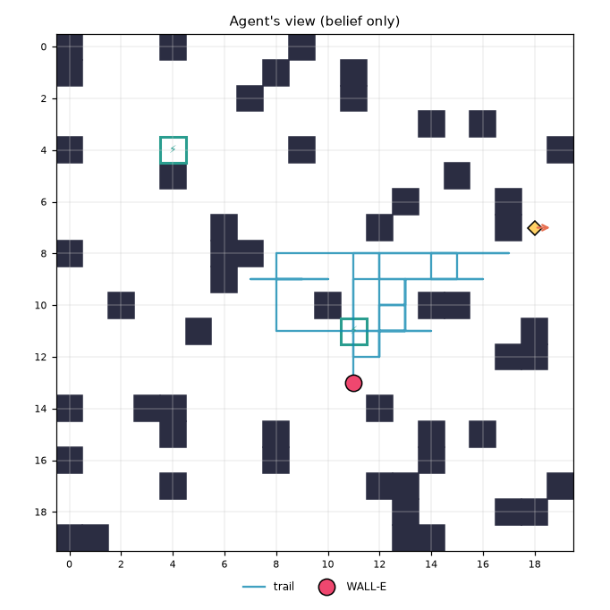

# Mission report: noisy_decoys / Random walk / seed 3

**Outcome:** `action_budget_exhausted`  (success=False)

| metric | value |
|---|---|
| strategy | random |
| seed | 3 |
| status | action_budget_exhausted |
| success | False |
| actions | 100 |
| scans | 10 |
| recharges | 12 |
| invalid_actions | 0 |
| energy_used | 108.0 |
| time_used | 110 |
| resource_exhausted | True |
| final_error | 7.0 |
| localized_exact | False |
| localized_within2 | False |
| final_entropy | None |
| final_confidence | 0.002890173410404624 |

Legend: W=WALL-E, E=EVE (ground truth, shown post-mission only), c=clue, S=station, +=trail, #=obstacle

```
#...#....#..........
#.......#..#........
.......#...#........
..............#.#...
#...S....#.........#
....#..........#..cc
.............#...#.c
......#.....#....#cE
#.....##++++++++++..
......#++++++++++...
..#.....+.#+++##....
.....#..+++S+++...#.
...........++....##.
...........W........
#..##.......#.......
....#...#.....#.#...
#.......#.....#.....
....#.......##.....#
.............#...##.
##...........##.....
```



## Decision log

| step | action | why |
|---|---|---|
| 1 | SCAN | random scan (reading ignored) |
| 2 | MOVE S | random step to (11, 12) |
| 3 | SCAN | random scan (reading ignored) |
| 4 | SCAN | random scan (reading ignored) |
| 5 | MOVE E | random step to (12, 12) |
| 6 | MOVE N | random step to (12, 11) |
| 7 | MOVE N | random step to (12, 10) |
| 8 | MOVE E | random step to (13, 10) |
| 9 | SCAN | random scan (reading ignored) |
| 10 | MOVE S | random step to (13, 11) |
| 11 | MOVE W | random step to (12, 11) |
| 12 | MOVE N | random step to (12, 10) |
| 13 | MOVE E | random step to (13, 10) |
| 14 | MOVE N | random step to (13, 9) |
| 15 | MOVE W | random step to (12, 9) |
| 16 | MOVE N | random step to (12, 8) |
| 17 | MOVE E | random step to (13, 8) |
| 18 | MOVE E | random step to (14, 8) |
| 19 | MOVE S | random step to (14, 9) |
| 20 | MOVE E | random step to (15, 9) |
| 21 | MOVE E | random step to (16, 9) |
| 22 | MOVE W | heading to recharge station (11, 11) (7 steps away): slack 4 < 6 |
| 23 | MOVE W | heading to recharge station (11, 11) (6 steps away): slack 4 < 6 |
| 24 | MOVE W | heading to recharge station (11, 11) (5 steps away): slack 4 < 6 |
| 25 | MOVE W | heading to recharge station (11, 11) (4 steps away): slack 4 < 6 |
| 26 | MOVE W | heading to recharge station (11, 11) (3 steps away): slack 4 < 6 |
| 27 | MOVE S | heading to recharge station (11, 11) (2 steps away): slack 4 < 6 |
| 28 | MOVE S | heading to recharge station (11, 11) (1 steps away): slack 4 < 6 |
| 29 | RECHARGE | recharging at station: arrived at station |
| 30 | RECHARGE | recharging (14/40) before resuming search |
| 31 | RECHARGE | recharging (24/40) before resuming search |
| 32 | RECHARGE | recharging (34/40) before resuming search |
| 33 | SCAN | random scan (reading ignored) |
| 34 | MOVE E | random step to (12, 11) |
| 35 | MOVE E | random step to (13, 11) |
| 36 | MOVE W | random step to (12, 11) |
| 37 | MOVE S | random step to (12, 12) |
| 38 | MOVE N | random step to (12, 11) |
| 39 | MOVE E | random step to (13, 11) |
| 40 | MOVE E | random step to (14, 11) |
| 41 | SCAN | random scan (reading ignored) |
| 42 | MOVE W | random step to (13, 11) |
| 43 | MOVE N | random step to (13, 10) |
| 44 | MOVE N | random step to (13, 9) |
| 45 | MOVE E | random step to (14, 9) |
| 46 | MOVE E | random step to (15, 9) |
| 47 | MOVE N | random step to (15, 8) |
| 48 | MOVE W | random step to (14, 8) |
| 49 | MOVE E | random step to (15, 8) |
| 50 | MOVE E | random step to (16, 8) |
| 51 | MOVE E | random step to (17, 8) |
| 52 | SCAN | random scan (reading ignored) |
| 53 | MOVE W | heading to recharge station (11, 11) (9 steps away): slack 5 < 6 |
| 54 | MOVE W | heading to recharge station (11, 11) (8 steps away): slack 5 < 6 |
| 55 | MOVE W | heading to recharge station (11, 11) (7 steps away): slack 5 < 6 |
| 56 | MOVE W | heading to recharge station (11, 11) (6 steps away): slack 5 < 6 |
| 57 | MOVE W | heading to recharge station (11, 11) (5 steps away): slack 5 < 6 |
| 58 | MOVE W | heading to recharge station (11, 11) (4 steps away): slack 5 < 6 |
| 59 | MOVE S | heading to recharge station (11, 11) (3 steps away): slack 5 < 6 |
| 60 | MOVE S | heading to recharge station (11, 11) (2 steps away): slack 5 < 6 |
| 61 | MOVE S | heading to recharge station (11, 11) (1 steps away): slack 5 < 6 |
| 62 | RECHARGE | recharging at station: arrived at station |
| 63 | RECHARGE | recharging (15/40) before resuming search |
| 64 | RECHARGE | recharging (25/40) before resuming search |
| 65 | RECHARGE | recharging (35/40) before resuming search |
| 66 | MOVE E | random step to (12, 11) |
| 67 | MOVE E | random step to (13, 11) |
| 68 | MOVE N | random step to (13, 10) |
| 69 | MOVE N | random step to (13, 9) |
| 70 | MOVE S | random step to (13, 10) |
| 71 | MOVE W | random step to (12, 10) |
| 72 | MOVE N | random step to (12, 9) |
| 73 | MOVE N | random step to (12, 8) |
| 74 | MOVE W | random step to (11, 8) |
| 75 | MOVE W | random step to (10, 8) |
| 76 | MOVE W | random step to (9, 8) |
| 77 | MOVE W | random step to (8, 8) |
| 78 | MOVE S | random step to (8, 9) |
| 79 | MOVE W | random step to (7, 9) |
| 80 | MOVE E | random step to (8, 9) |
| 81 | MOVE E | random step to (9, 9) |
| 82 | SCAN | random scan (reading ignored) |
| 83 | SCAN | random scan (reading ignored) |
| 84 | MOVE E | random step to (10, 9) |
| 85 | MOVE W | random step to (9, 9) |
| 86 | SCAN | random scan (reading ignored) |
| 87 | MOVE W | random step to (8, 9) |
| 88 | MOVE E | random step to (9, 9) |
| 89 | MOVE W | random step to (8, 9) |
| 90 | MOVE S | heading to recharge station (11, 11) (5 steps away): slack 5 < 6 |
| 91 | MOVE S | heading to recharge station (11, 11) (4 steps away): slack 5 < 6 |
| 92 | MOVE E | heading to recharge station (11, 11) (3 steps away): slack 5 < 6 |
| 93 | MOVE E | heading to recharge station (11, 11) (2 steps away): slack 5 < 6 |
| 94 | MOVE E | heading to recharge station (11, 11) (1 steps away): slack 5 < 6 |
| 95 | RECHARGE | recharging at station: arrived at station |
| 96 | RECHARGE | recharging (15/40) before resuming search |
| 97 | RECHARGE | recharging (25/40) before resuming search |
| 98 | RECHARGE | recharging (35/40) before resuming search |
| 99 | MOVE S | random step to (11, 12) |
| 100 | MOVE S | random step to (11, 13) |